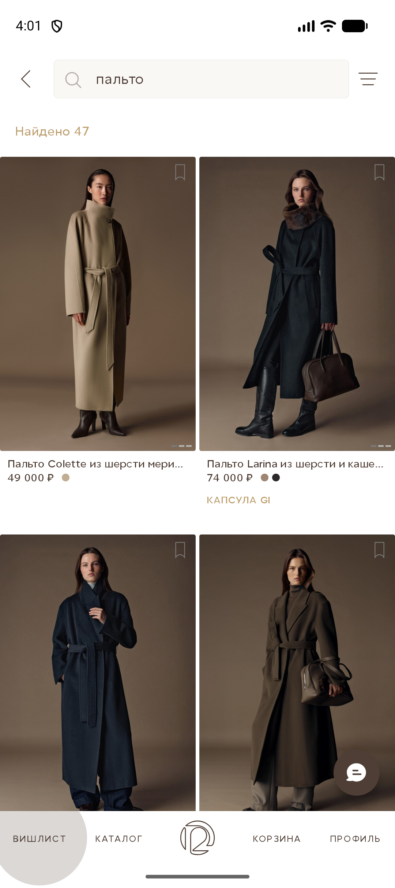

<h1 align="center">Мобильное направление</h1>
<h2 align="center">автотесты Android-приложения <a href="https://12storeez.com">12 STOREEZ</a></h2>

<p align="center">
  <a href="https://12storeez.com/" title="12 STOREEZ — официальный сайт">
    
  </a>
</p>

> Автотесты покрывают ключевые сценарии Android-приложения **12 STOREEZ** (версия 1.60.0):
> онбординг первого запуска, каталог и карточка товара, корзина, список избранного.
> Прогоны выполняются локально на эмуляторе/реальном устройстве через Appium
> и удалённо в облаке **BrowserStack** (режим по умолчанию).

____

## Содержание

* <a href="#tools">Технологии и инструменты</a>
* <a href="#cases">Автоматизированные тест-кейсы</a>
* <a href="#structure">Структура проекта</a>
* <a href="#console">Запуск тестов из терминала</a>
* <a href="#jenkins">Сборка в Jenkins</a>
* <a href="#allure">Allure-отчёт</a>
* <a href="#video">Видео прохождения тестов</a>
* <a href="#notes">Особенности реализации</a>

____

<a id="tools"></a>
## Технологии и инструменты

<p align="center">
  <a href="https://www.jetbrains.com/idea/"></a>
  <a href="https://www.java.com/"></a>
  <a href="https://gradle.org/"></a>
  <a href="https://junit.org/junit5/"></a>
  <a href="https://selenide.org/"></a>
  <a href="https://appium.io/"></a>
  <a href="https://developer.android.com/studio"></a>
  <a href="https://www.browserstack.com/"></a>
  <a href="https://github.com/allure-framework/allure2"></a>
  <a href="https://www.jenkins.io/"></a>
  <a href="https://github.com/"></a>
</p>

- Автотесты написаны на **Java** с использованием **Selenide** и **JUnit 5**.
- Драйвер мобильного приложения — **Appium** (автоматизация **UIAutomator2**).
- Запуск возможен на эмуляторе, реальном устройстве и в облаке **BrowserStack**.
- Конфигурация стендов — через **Owner** (`emulation.properties`, `real.properties`, `config.properties`).
- Каждый тест начинается с чистой установки приложения (`fullReset`) — полная изоляция прогонов.
- CI — **Jenkins** с формированием **Allure Report** (скриншот, Page Source, видео и логи сессии BrowserStack).

____

<a id="cases"></a>
## Автоматизированные тест-кейсы

**Онбординг первого запуска:**
- Первый запуск: экраны онбординга до главного экрана по кнопке «Не сейчас»;
- Первый запуск: переход к экрану авторизации по кнопке «Авторизоваться».

**Корзина:**
- Добавление товара в корзину (выбор размера) и проверка товара в корзине;
- Очистка корзины: корзина становится пустой;
- Пустая корзина сразу после запуска (заголовок и кнопка «Перейти в каталог»).

**Список избранного:**
- Добавление товара в список избранного с карточки товара и проверка товара в списке;
- Удаление товара из списка избранного по кнопке удаления.

**Каталог:**
- Открытие первого товара раздела «Новинки» через нижнюю навигацию «Каталог».

<p align="center">
  
  
  
  
</p>

____

<a id="structure"></a>
## Структура проекта

```
src/mobileTest
├── java/mobile
│   ├── config        ← конфиги стендов на Owner (Run, BrowserStack, Emulation, RealDevice)
│   ├── drivers       ← DriverFactory, LocalDriver, EmulationDriver, RealDeviceDriver, BrowserstackDrivers
│   ├── helpers       ← вложения Allure (Attach), клиент API BrowserStack
│   ├── locators      ← TwelveStoreezLocators (UiSelector/XPath)
│   ├── steps         ← OnboardingSteps, CatalogSteps, CartSteps, WishlistSteps
│   └── tests         ← TestBase, OnboardingTest, CartTests, WishlistTests
└── resources         ← emulation.properties, real.properties, config.properties
```

____

<a id="console"></a>
## Запуск тестов из терминала

### Удалённый запуск в BrowserStack (по умолчанию)

Достаточно выполнить — стенд `browserstack` выбран по умолчанию, данные аккаунта и приложение (`bs://…`) хранятся в `config.properties`:

```bash
gradlew clean mobileTest
```

### Локальный запуск на эмуляторе

Перед запуском: Android SDK с эмулятором создан и запущен, поднят Appium-сервер:

```bash
appium
```

Затем:

```bash
gradlew clean mobileTest -DdeviceHost=emulation -Ddevice.udid=emulator-5554 -Dappium.url=http://127.0.0.1:4723/
```

### Локальный запуск на реальном устройстве

```bash
gradlew clean mobileTest -DdeviceHost=real -Ddevice.udid=<серийный номер из adb devices> -Dappium.url=http://127.0.0.1:4723/
```

### Параметры запуска

| Параметр | Описание |
|---|---|
| `deviceHost` | Стенд запуска: `browserstack` (по умолчанию), `emulation`, `real` |
| `device.udid` | Серийный номер устройства/эмулятора (`adb devices`) |
| `appium.url` | Адрес локального Appium-сервера |

____

<a id="jenkins"></a>
##  <a href="https://jenkins.qa.guru/job/aukolova-12STOREEZ-Mobile/">Сборка в Jenkins</a>

Удалённый прогон мобильных тестов выполняется джобой **aukolova-12STOREEZ-Mobile** на Jenkins: тесты уходят в облако BrowserStack, по завершении формируется Allure-отчёт.

Команда сборки:

```bash
gradle clean mobileTest
```

____

<a id="allure"></a>
##  Allure-отчёт

Содержание отчёта по мобильным тестам:
* шаги теста (аннотации `@Step` и действия Selenide);
* скриншот последнего экрана;
* Page Source (иерархия UI в момент завершения);
* видео выполнения сессии и логи (Appium / устройства) — при прогоне в BrowserStack.

<p align="center">
  
</p>

____

<a id="video"></a>
## Видео прохождения тестов

При прогоне в BrowserStack к каждому тесту в отчёте прикладывается видео сессии целиком — от установки приложения до закрытия сессии.

____

<a id="notes"></a>
## Особенности реализации

- **Приложение написано на Jetpack Compose**, поэтому значительная часть локаторов построена на `UiSelector` по тексту (`text` / `textContains` / `textMatches`); для многословных строк используются регэкспы с `\s+`, потому что в приложении встречаются неразрывные пробелы.
- **Чистая установка перед каждым тестом** (`fullReset`): приложение удаляется после сессии и ставится заново — каждый тест начинается с настоящего первого запуска.
- **Строгие ожидания вместо ретраев**: действия выполняются один раз, дальше работают стандартные ожидания Selenide — если экран не открылся, тест честно падает.
- **Восстановление после ошибки холодного старта**: если при свежей установке приложение показывает экран «Что-то пошло не так», прогон сам нажимает «Повторить попытку» и дожидается онбординга.
- **Изоляция версий**: web и mobile направления живут в одном репозитории, но с разными classpath (Selenide 7.x для web, 6.13 + Appium 8.3 для mobile) и независимыми Gradle-задачами `test` и `mobileTest`.

____

← [Вернуться к основному README](README.md)
