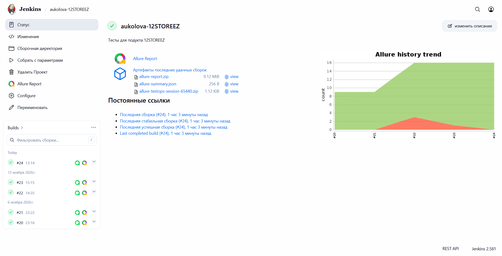
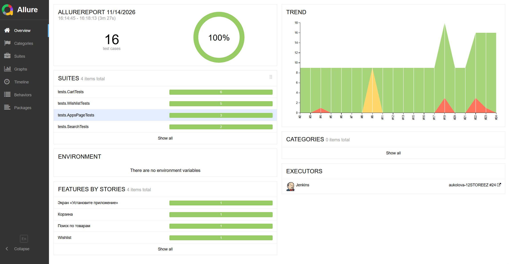
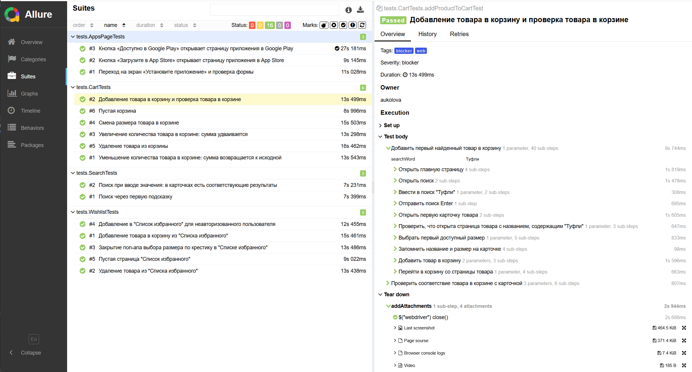
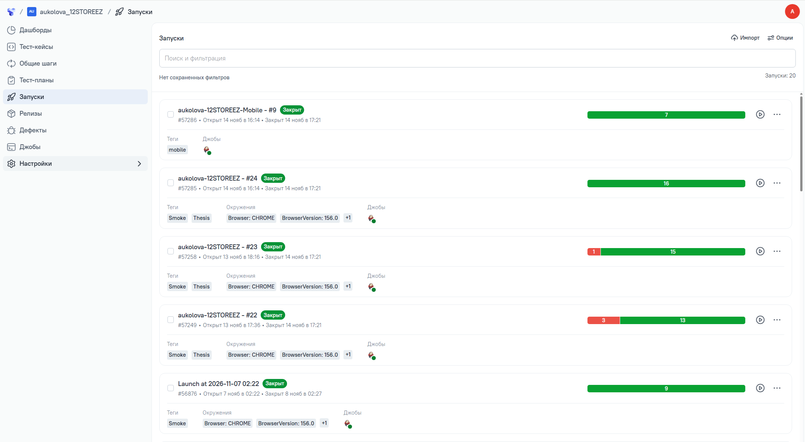
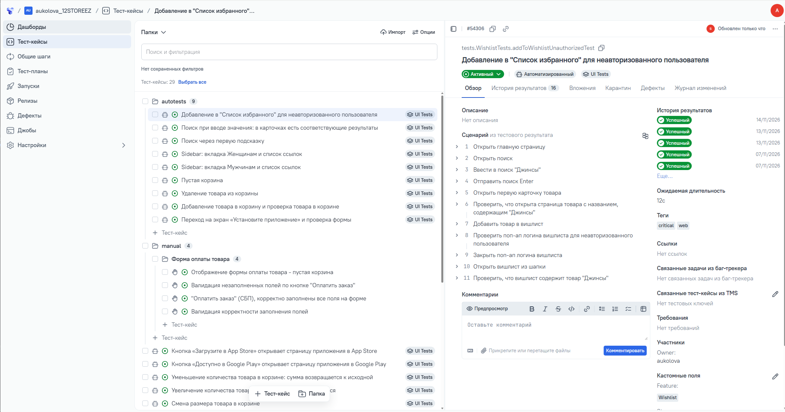
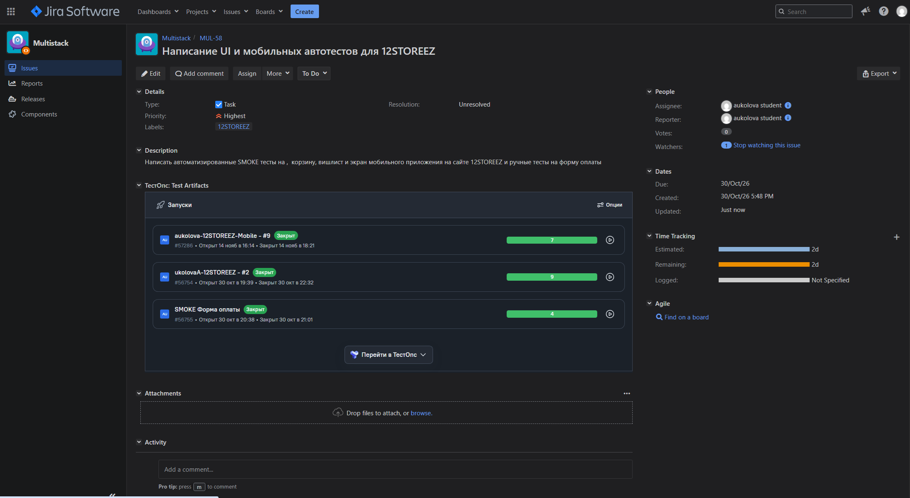
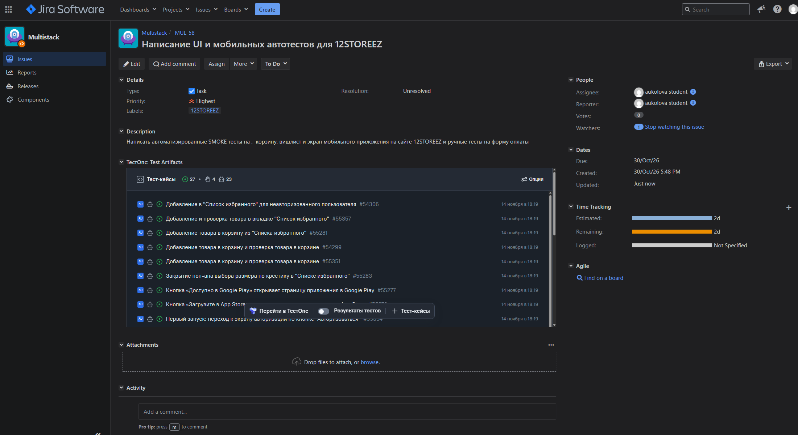
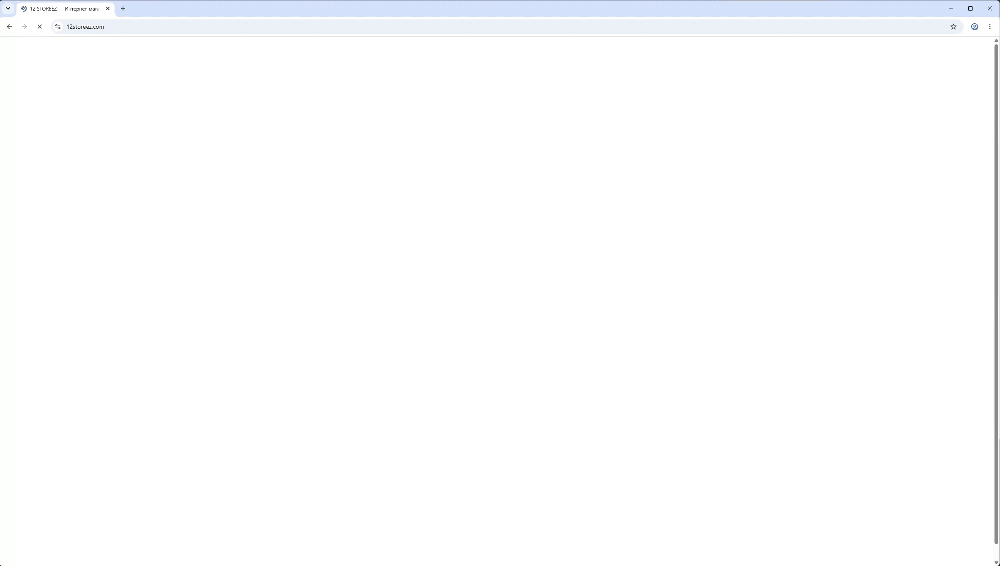
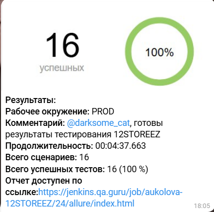

<h1 align="center">Проект по автоматизации тестирования</h1>
<h2 align="center">интернет-магазина и Android-приложения <a href="https://12storeez.com">12STOREEZ</a> </h2>

<p align="center">
  <a href="https://12storeez.com/" title="12 STOREEZ — официальный сайт">
    
  </a>
</p>

> **12 STOREEZ** — российский fashion-бренд одежды и аксессуаров для женщин и мужчин.  
> Современный гардероб с акцентом на качество, чистый силуэт и повседневный стиль.  
> Официальный интернет-магазин: [12storeez.com](https://12storeez.com/).

____

## Содержание

* <a href="#tools">Технологии и инструменты</a>
* <a href="#mobile">Мобильное приложение</a>
* <a href="#cases">Тест-план автоматизированных тест-кейсов</a>
* <a href="#cases">Тест-план ручных тест-кейсов (ТестОпс)</a>
* <a href="#structure">Структура проекта</a>
* <a href="#console">Запуск тестов из терминала</a>
* <a href="#jenkins">Сборка в Jenkins</a>
* <a href="#allure">Allure-отчёт</a>
* <a href="#allure-testops">Интеграция с Allure ТестОпс</a>
* <a href="#jira">Интеграция с Jira</a>
* <a href="#video">Видео прохождения тестов</a>
* <a href="#telegram">Уведомления в Telegram</a>
____

<a id="tools"></a>
## Технологии и инструменты

<p align="center">
  <a href="https://www.jetbrains.com/idea/"></a>
  <a href="https://www.java.com/"></a>
  <a href="https://gradle.org/"></a>
  <a href="https://junit.org/junit5/"></a>
  <a href="https://selenide.org/"></a>
  <a href="https://aerokube.com/selenoid/"></a>
  <a href="https://appium.io/"></a>
  <a href="https://developer.android.com/studio"></a>
  <a href="https://www.browserstack.com/"></a>
  <a href="https://github.com/allure-framework/allure2"></a>
  <a href="https://qameta.io/"></a>
  <a href="https://www.jenkins.io/"></a>
  <a href="https://www.atlassian.com/software/jira/"></a>
  <a href="https://github.com/"></a>
  <a href="https://web.telegram.org/"></a>
</p>

- Автотесты написаны на **Java** с использованием **Selenide** и **JUnit 5**.
- Сборка проекта — **Gradle**.
- Удалённый запуск браузеров — **Selenoid** (VNC + video).
- Мобильные автотесты — **Appium** (UIAutomator2): локально на эмуляторе/девайсе и в облаке **BrowserStack**.
- CI — **Jenkins** с формированием **Allure Report**.
- Результаты и тест-кейсы — в **Allure ТестОпс**, интеграция с **Jira**.
- Уведомления о прогоне — в **Telegram** через бота.

Содержание Allure-отчёта:
* шаги теста;
* скриншот на последнем шаге;
* Page Source;
* логи браузерной консоли;
* видео выполнения теста (Selenoid);
* видео и логи мобильной сессии (BrowserStack).

____

<a id="mobile"></a>
##  Мобильное приложение

📱Автотесты Android-приложения **12 STOREEZ** (версия 1.60.0): технологии, тест-кейсы, запуск, особенности реализации и другую подробную информацию по мобильному приложению можно найти на странице: **[MOBILE.md](MOBILE.md)**.
<p align="center">
  
  
</p>


____

<a id="cases"></a>
## Тест-план автоматизированных тест-кейсов
 
**Страница установки приложения:**
- Переход на экран «Установите приложение» и проверка формы экрана;
- Кнопка «Загрузите в App Store» открывает страницу приложения в App Store;
- Кнопка «Доступно в Google Play» открывает страницу приложения в Google Play.

**Поиск:**
- Поиск при вводе значения: в карточках есть соответствующие результаты;
- Поиск через первую подсказку.

**Корзина:**
- Добавление товара в корзину и проверка товара в корзине;
- Удаление товара из корзины;
- Пустая корзина;
- Смена размера товара в корзине;
- Увеличение количества товара в корзине: сумма удваивается;
- Уменьшение количества товара в корзине: сумма возвращается к исходной.

**Список избранного:**
- Добавление в "Список избранного" для неавторизованного пользователя (pop-up "Вход и регистрация");
- Пустая страница "Список избранного";
- Удаление товара из "Списка избранного";
- Добавление товара в корзину из "Списка избранного";
- Закрытие поп-апа выбора размера по крестику в "Списке избранного".

**Мобильное приложение (Android, подробно — [MOBILE.md](MOBILE.md)):**
- Онбординг первого запуска: экраны онбординга до главного экрана по кнопке «Не сейчас»;
- Онбординг первого запуска: переход к экрану авторизации по кнопке «Авторизоваться»;
- Каталог: открытие первого товара раздела «Новинки» через нижнюю навигацию;
- Корзина: добавление товара (выбор размера) и проверка товара в корзине;
- Корзина: очистка корзины с подтверждением — корзина становится пустой;
- Корзина: пустая корзина после запуска (заголовок «Корзина пока пуста» и кнопка «Перейти в каталог»);
- Список избранного: добавление товара с карточки товара и проверка товара в списке;
- Список избранного: удаление товара из списка по кнопке удаления.

## Тест-план ручных тест-кейсов (ТестОпс)
- "Оплатить заказ" (СБП), корректно заполнены все поля на форме;
- Валидация незаполненных полей по кнопке "Оплатить заказ";
- Валидация корректности заполнения полей;
- Отображение формы оплаты товара - пустая корзина.
____

<a id="structure"></a>
## Структура проекта

```
src/test/java/
├── config/       # Owner-конфиги: WebDriverConfig, AuthConfig, ConfigReader, ProjectConfiguration
├── helpers/      # Attach — вложения Allure (скриншот, page source, логи консоли, видео)
├── pages/        # PageObject: MainPage, SearchPage, ProductPage, CartPage, WishlistPage, AppsPage
├── steps/        # PurchaseSteps — сценарии покупки
├── testdata/     # TestData — тестовые данные и константы
├── tests/        # TestBase + SearchTests, CartTests, WishlistTests, AppsPageTests
└── utils/        # SearchQueryGenerator — генерация поисковых запросов

src/test/resources/
├── auth.properties      # креды для удалённого запуска
├── local.properties     # локальный запуск (браузер, headless)
└── selenoid.properties  # удалённый запуск через Selenoid

src/main/java/io/qameta/allure/   # кастомные аннотации @Layer, @JiraIssue(s) — общие с mobile
```
____

<a id="console"></a>
## Запуск тестов из терминала

### Локальный запуск

```bash
gradlew clean test
```

### Удалённый запуск

***Удалённый запуск через Jenkins:***
```bash  
clean 
"-Dbrowser=${browser}"
"-DbrowserVersion=${browserVersion}"
"-DbrowserSize=${browserSize}"
"-DbaseUrl=${baseUrl}"
"-Dremote=${remoteUrl}"
"-Dheadless=${HEADLESS}"
```
### Параметры запуска

| Параметр | Описание |
|---|---|
| `remote` | URL удалённого WebDriver / Selenoid |
| `browser` | Браузер |
| `browserVersion` | Версия браузера |
| `browserSize` | Размер окна |
| `baseUrl` | Базовый URL приложения |
| `headless` | Headless-режим |

____

<a id="jenkins"></a>
##  <a href="https://jenkins.qa.guru/job/ukolovaA-12STOREEZ/">Сборка в Jenkins</a>

<p align="center">
  
</p>

____

<a id="allure"></a>
##  <a href="https://jenkins.qa.guru/job/ukolovaA-12STOREEZ/8/allure/">Allure-отчёт</a>

### Overview

<p align="center">
  
</p>

### Результаты выполнения теста

<p align="center">
  
</p>

____

<a id="allure-testops"></a>
##  <a href="https://allure.qa.guru/project/5401/dashboards/5700">Интеграция с Allure ТестОпс</a>

Выполнена интеграция сборки Jenkins с **Allure ТестОпс**. Каждый тест размечен аннотациями `@Story`, `@JiraIssues`, `@Tags`, `@Severity` и `@DisplayName`.  

### Запуски

<p align="center">
  
</p>

### Тест-кейсы в ТестОпс

<p align="center">
  
</p>

____

<a id="jira"></a>
##  <a href="https://jira.qa.guru/browse/MUL-58">Интеграция с Jira</a>

Реализована интеграция **Allure ТестОпс** с **Jira**: в тикете отображаются связанные тест-кейсы и результаты прогонов.

### Запуски
<p align="center">
  
</p>

### Тест-кейсы
<p align="center">
  
</p>

____
<a id="video"></a>
##  Видео прохождения тестов в Selenoid

К каждому тесту в отчёте прилагается видео прогона.

Кейс: "Удаление товара из корзины"
<p align="center">
  
</p>

____

<a id="telegram"></a>
##  Уведомления в Telegram

После завершения сборки бот в Telegram отправляет сообщение с результатом прогона.

<p align="center">
  
</p>

____


