<p align="center">
  Проект по автоматизации тестирования сайта <br>
  <b><a href="https://12storeez.com/">12STOREEZ</a></b>
</p>

<p align="center">
  <a href="https://12storeez.com/" title="12 STOREEZ — официальный сайт">
    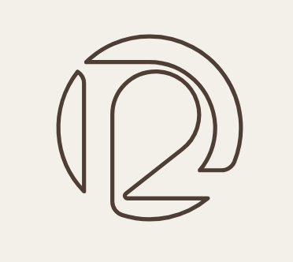
  </a>
</p>

> **12 STOREEZ** — российский fashion-бренд одежды и аксессуаров для женщин и мужчин.  
> Современный гардероб с акцентом на качество, чистый силуэт и повседневный стиль.  
> Официальный интернет-магазин: [12storeez.com](https://12storeez.com/).

____

## Содержание

* <a href="#tools">Технологии и инструменты</a>
* <a href="#cases">Тест-план автоматизированных тест-кейсов</a>
* <a href="#cases">Тест-план ручных тест-кейсов (ТестОпс)</a>
* <a href="#console">Запуск тестов из терминала</a>
* <a href="#jenkins">Сборка в Jenkins</a>
* <a href="#allure">Allure-отчёт</a>
* <a href="#allure-testops">Интеграция с Allure ТестОпс</a>
* <a href="#jira">Интеграция с Jira</a>
* <a href="#video">Видео прохождения тестов</a>
* <a href="#telegram">Уведомления в Telegram</a>
____

<a id="tools"></a>
## Технологии и инструменты

<p align="center">
  <a href="https://www.jetbrains.com/idea/"></a>
  <a href="https://www.java.com/"></a>
  <a href="https://gradle.org/"></a>
  <a href="https://junit.org/junit5/"></a>
  <a href="https://selenide.org/"></a>
  <a href="https://aerokube.com/selenoid/">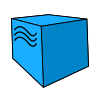</a>
  <a href="https://github.com/allure-framework/allure2"></a>
  <a href="https://qameta.io/"></a>
  <a href="https://www.jenkins.io/"></a>
  <a href="https://www.atlassian.com/software/jira/"></a>
  <a href="https://github.com/"></a>
  <a href="https://web.telegram.org/"></a>
</p>

- Автотесты написаны на **Java** с использованием **Selenide** и **JUnit 5**.
- Сборка проекта — **Gradle**.
- Удалённый запуск браузеров — **Selenoid** (VNC + video).
- CI — **Jenkins** с формированием **Allure Report**.
- Результаты и тест-кейсы — в **Allure ТестОпс**, интеграция с **Jira**.
- Уведомления о прогоне — в **Telegram** через бота.

Содержание Allure-отчёта:
* шаги теста;
* скриншот на последнем шаге;
* Page Source;
* логи браузерной консоли;
* видео выполнения теста (Selenoid).

____

<a id="cases"></a>
## Тест-план автоматизированных тест-кейсов
 
- Переход на экран «Установите приложение» и проверка формы экрана "Установите приложение";
- Поиск по слову: в карточках есть соответствующие результаты;
- Поиск через предложенные тэги: в карточках есть соответствующие результаты;
- Добавление товара в корзину и проверка добавленного товара в корзине;
- Удаление товара из корзины;
- Пустая корзина;
- Добавление в вишлист для неавторизованного пользователя (pop-up "Вход и регистрация");
- Левое меню: проверка списка ссылок коллекции с вкладки «Женщинам»;
- Левое меню: проверка списка ссылок коллекции с вкладки «Мужчинам».

## Тест-план ручных тест-кейсов (ТестОпс)
- "Оплатить заказ" (СБП), корректно заполнены все поля на форме;
- Валидация незаполненных полей по кнопке "Оплатить заказ";
- Валидация корректности заполнения полей;
- Отображение формы оплаты товара - пустая корзина.
____

<a id="console"></a>
## Запуск тестов из терминала

### Локальный запуск

```bash
gradlew clean test
```

### Удалённый запуск

***Удалённый запуск через Jenkins:***
```bash  
clean X5Group_test
"-Dbrowser=${browser}"
"-DbrowserVersion=${browserVersion}"
"-DbrowserSize=${browserSize}"
"-DbaseUrl=${baseUrl}"
"-Dremote=${remoteUrl}"
"-Dheadless=${HEADLESS}"
```
### Параметры запуска

| Параметр | Описание |
|---|---|
| `remote` | URL удалённого WebDriver / Selenoid |
| `browser` | Браузер |
| `browserVersion` | Версия браузера |
| `browserSize` | Размер окна |
| `baseUrl` | Базовый URL приложения |
| `headless` | Headless-режим |

____

<a id="jenkins"></a>
##  Сборка в Jenkins


<p align="center">
  <a href="https://jenkins.qa.guru/view/java-students/job/ukolovaA-12STOREEZ/">
    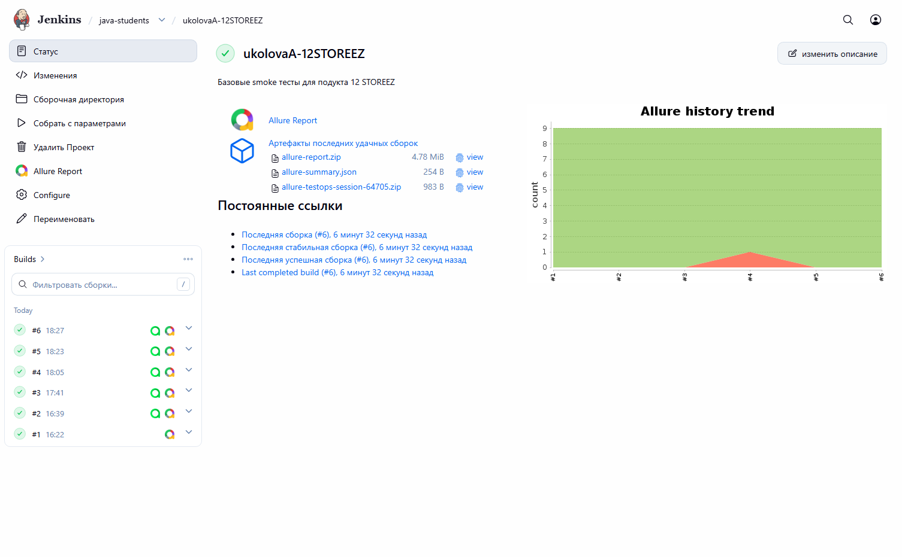
  </a>
</p>

____

<a id="allure"></a>
##  Allure-отчёт

### Overview

<p align="center">
  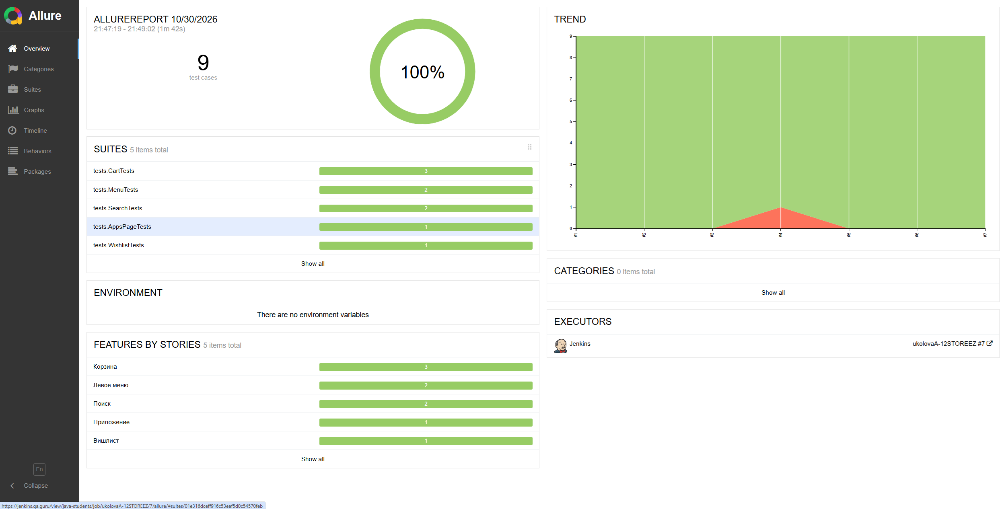
</p>

### Результаты выполнения теста

<p align="center">
  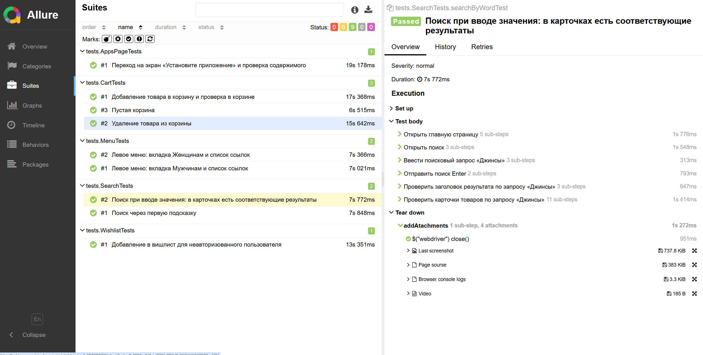
</p>

____

<a id="allure-testops"></a>
##  Интеграция с Allure ТестОпс

Выполнена интеграция сборки Jenkins с **Allure ТестОпс**.  

### Запуски

<p align="center">
  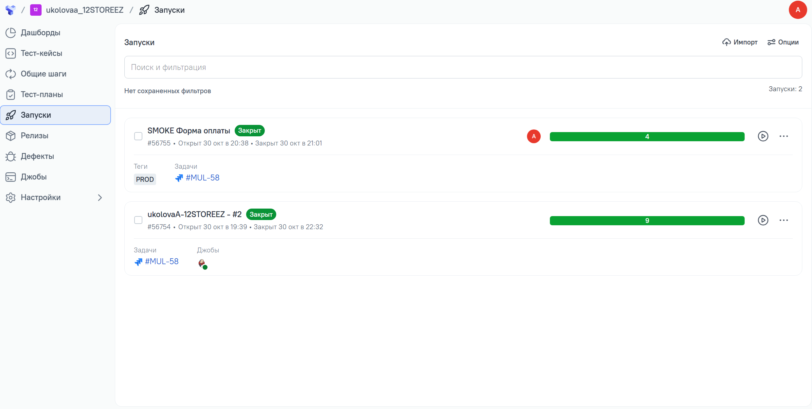
</p>

### Тест-кейсы в ТестОпс

<p align="center">
  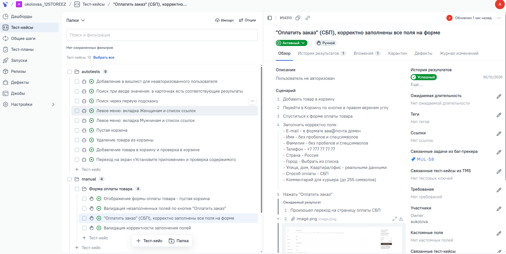
</p>

____

<a id="jira"></a>
##  Интеграция с Jira

Реализована интеграция **Allure ТестОпс** с **Jira**: в тикете отображаются связанные тест-кейсы и результаты прогонов.

### Запуски
<p align="center">
  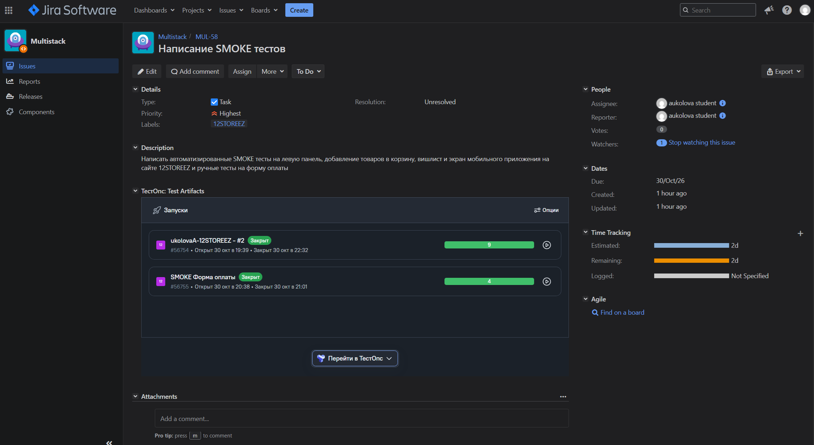
</p>

### Тест-кейсы
<p align="center">
  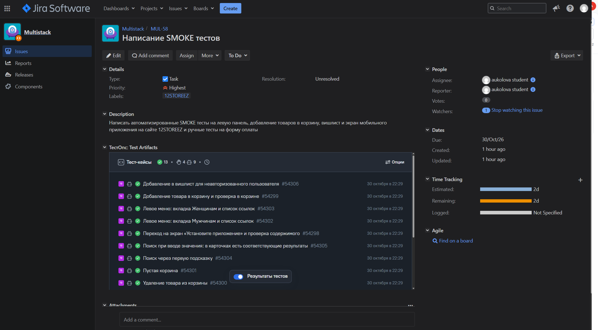
</p>

____
<a id="video"></a>
##  Видео прохождения тестов в Selenoid

К каждому тесту в отчёте прилагается видео прогона.

Кейс: "Удаление товара из корзины"
<p align="center">
  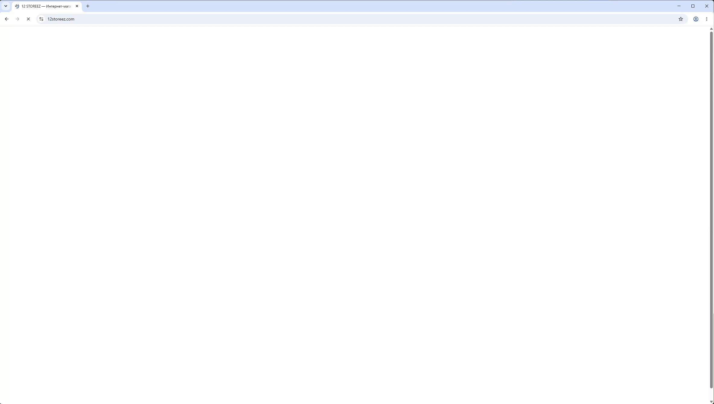
</p>

____

<a id="telegram"></a>
##  Уведомления в Telegram

После завершения сборки бот в Telegram отправляет сообщение с результатом прогона.

<p align="center">
  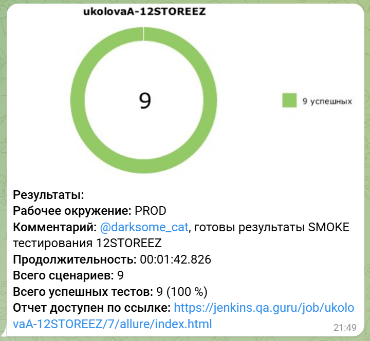
</p>

____


